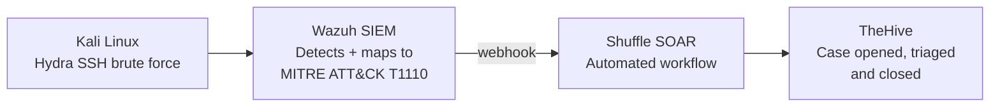

# Mohammed Asim Ahmed

### Blue Team & SOC · Detection and Incident Response

I build SOC pipelines in a home lab: simulate the attack, detect it in the SIEM, automate the response, and track the case to closure.

[-C8202F?style=for-the-badge)](https://www.credly.com/badges/3ea43fb8-b30d-4938-87dd-805382150d08/public_url)

📍 UAE · 🎓 Bachelor's in Cyber Security, University of Wollongong in Dubai (Distinction) · 🔎 Open to SOC Analyst & Security Roles

---

## 🛡️ Featured: end-to-end SOC pipeline

**[Wazuh–Shuffle–TheHive SOC Lab →](https://github.com/Asimsvictus/Wazuh-Shuffle-TheHive-SOC-Lab)** An SSH brute force from Kali is detected by Wazuh, enriched and automated in Shuffle, then raised as a TheHive case and worked through to closure. TheHive runs in Docker on its own Ubuntu VM.

---

## 🧪 Projects

| Project | What it shows | Stack |
|:---|:---|:---|
| [**Wazuh–Shuffle–TheHive SOC Lab**](https://github.com/Asimsvictus/Wazuh-Shuffle-TheHive-SOC-Lab) | Full detect → automate → case-management pipeline, with a brute-force incident taken to a closed case | Wazuh · Shuffle · TheHive · Docker |
| [**Wazuh–Shuffle SOAR Lab**](https://github.com/Asimsvictus/Wazuh-Shuffle-SOAR-Lab) | Hydra SSH brute force detected by Wazuh, mapped to MITRE ATT&CK T1110 and forwarded by webhook to an automated Shuffle workflow | Wazuh · Shuffle · MITRE ATT&CK |
| [**Home SOC Lab**](https://github.com/Asimsvictus/home-soc-lab) | 3-VM attack and detection lab (Kali, Windows, Ubuntu). Nmap, Hydra and Metasploit attacks produced **171+ alerts** mapped to MITRE ATT&CK | Wazuh · Kali · Metasploit |
| [**Splunk SIEM Lab**](https://github.com/Asimsvictus/splunk-siem-lab) | Windows event log ingestion, SPL detections for failed logons, a custom dashboard and automated alerting | Splunk · SPL |
| [**Vulnerability Scanner Lab**](https://github.com/Asimsvictus/vulnerability-scanner-lab) | Credentialed Nessus assessment of a Windows 10 target: **5 High-severity CVEs** (CVSS up to 8.8), full PDF report | Nessus |
| [**Network Traffic Analyser**](https://github.com/Asimsvictus/network-traffic-analyser) | Python tool that detects port scans from live TCP capture, with **2,000+ alerts** logged across test runs | Python · Scapy |
| [**Phishing Analysis Toolkit**](https://github.com/Asimsvictus/phishing-analyser) | Automated phishing email triage with header analysis and VirusTotal API lookups | Python · VirusTotal API |
| [**CTF Writeups**](https://github.com/Asimsvictus/ctf-writeups) | TryHackMe and CTF walkthroughs, e.g. Blue room: EternalBlue (MS17-010) to SYSTEM, then NTLM hash dump and crack | Metasploit · Kali |

---

## 💼 Experience

- **Blue Team (SOC) Intern, Cyber 50 Defense Academy:** deployed a full Wazuh stack (indexer, manager, dashboard) with Windows and Linux agents, then integrated Shuffle SOAR and TheHive
- **Support Engineer Intern, SST Smart & Sustainable Technologies:** designed a Wazuh SIEM deployment on a Sangfor HCI private cloud, hardened 5G routers in a live field deployment and configured IPsec site-to-site VPNs

---

## 🧰 Toolkit

**SIEM & SOAR**

**Attack simulation (to test detections)**

**Network & vulnerability**

**Frameworks, scripting & infrastructure**

---

## 📜 Certifications

| Certification | Status |
|:---|:---|
| **CompTIA Security+ (SY0-701)** | ✅ Certified, Sep 2026 · [Verify on Credly](https://www.credly.com/badges/3ea43fb8-b30d-4938-87dd-805382150d08/public_url) |
| **TryHackMe SOC Level 1** | 🔄 In progress |

---

## 🔭 Currently

- Working through the **TryHackMe SOC Level 1** pathway: log analysis, threat hunting and incident response
- Writing up the Wazuh–Shuffle–TheHive lab and planning the next detection use case
